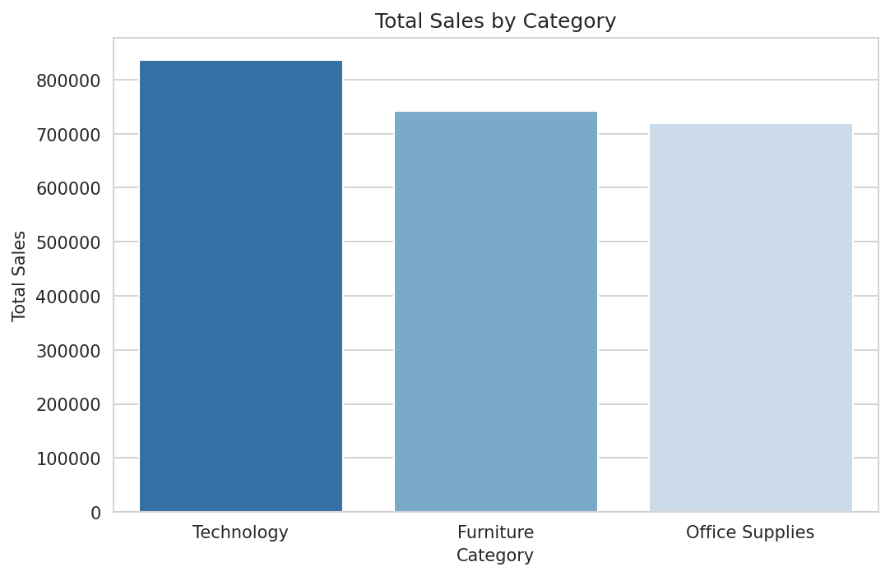
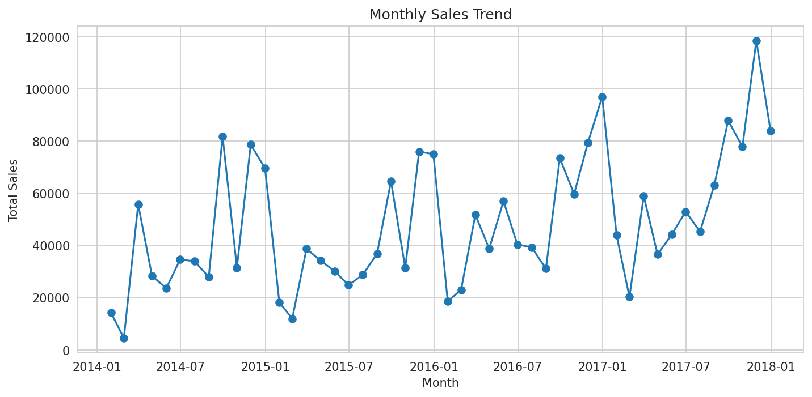
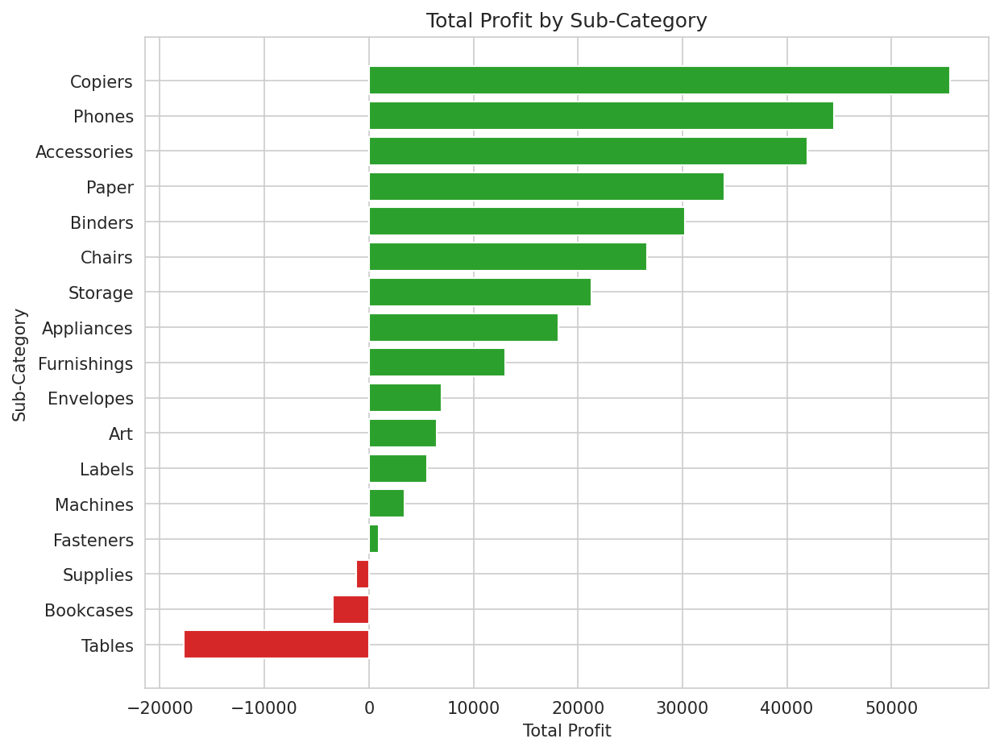

# Superstore Sales Analytics

An end-to-end data analytics project on the Sample Superstore dataset using Python and Power BI.

## Project Overview
This project covers data cleaning, exploratory data analysis (EDA), data visualization, an interactive Power BI dashboard and data-driven business recommendations.

## Problem Statement
The business wants to understand which categories, regions and customer segments drive sales and profit, and where discounts or pricing are hurting profitability.

## Dataset Description
- **Source:** Sample - Superstore (Orders, People and Returns sheets)
- **Size:** 9,994 rows and 21 columns (Orders sheet)
- **Key columns:** Order Date, Ship Mode, Segment, Region, Category, Sub-Category, Sales, Quantity, Discount, Profit

## Tools Used
Python (Pandas, NumPy, Matplotlib, Seaborn), Google Colab, Power BI Desktop, Git and GitHub

## Data Cleaning Process
- Inspected shape, data types, missing values and duplicates
- Removed duplicate and invalid records (non-positive sales or quantity)
- Converted Order Date and Ship Date to datetime and Postal Code to text
- Trimmed and standardized text columns (Customer Name, City, State)
- Renamed Sub-Category to SubCategory
- Created Order Year, Order Month and Profit Margin columns
- Dropped the unnecessary Row ID column
- Cleaned data saved as `data/superstore_cleaned.csv`

## Exploratory Data Analysis
**Correlation analysis**
| Pair | Correlation |
|---|---|
| Sales vs Profit | 0.48 (moderate positive) |
| Discount vs Profit | -0.22 (negative) |
| Sales vs Quantity | 0.20 (weak positive) |
| Discount vs Sales | -0.03 (almost none) |

Higher discounts are linked with lower profit, while higher sales generally bring higher profit.

**Outliers (IQR method)**
- Sales: 1,167 outliers (11.7%)
- Profit: 1,881 outliers (18.8%)

These are genuine large orders and heavy-loss transactions, so they were kept in the analysis.

**Patterns**
- Technology is the top category (836,154 sales), followed by Furniture (741,999) and Office Supplies (719,047)
- West has the highest profit (108,418); Central has the lowest (39,706)
- Sales fell slightly in 2015 and then grew every year to 733,215 in 2017
- Loss-making sub-categories: Tables (-17,725), Bookcases (-3,473) and Supplies (-1,189)

Notebook: `notebooks/Superstore_Analysis.ipynb`

## Visualizations
| Chart | File |
|---|---|
| Sales by Category | visualizations/1_sales_by_category.png |
| Monthly Sales Trend | visualizations/2_monthly_sales_trend.png |
| Profit by Sub-Category | visualizations/3_profit_by_subcategory.png |
| Correlation Heatmap | visualizations/4_correlation_heatmap.png |
| Discount vs Profit | visualizations/5_discount_vs_profit.png |
| Sales and Profit by Region | visualizations/6_region_sales_profit.png |





## Power BI Dashboard
Interactive dashboard with KPI cards (Total Sales, Total Profit, Profit Margin %, Total Orders), five visuals and Region and Category slicers. The `.pbix` file is in the `powerbi/` folder.


## Key Insights
1. Total Sales are 2.30M and Total Profit is 286.40K, a profit margin of 12.47%.
2. Technology is the top-selling category and Office Supplies the lowest, but all three are close.
3. West leads in sales and profit, while Central earns low profit despite higher sales than South.
4. Sales grew steadily from 2015 to 2017, with 2017 the best year.
5. Consumer is the largest segment (50.56% of sales), and Home Office the smallest (18.7%).
6. Tables, Bookcases and Supplies make a loss, and higher discounts reduce profit (correlation -0.22).

## Business Recommendations
1. **Control discounts:** Discount and profit are negatively correlated. Cap discounts, especially on Tables and Bookcases, which are the biggest loss makers.
2. **Fix the Central region:** Its margin is about 7.9% versus about 14.9% in the West. Review pricing and discounting there.
3. **Invest in high-profit products:** Increase stock and marketing for Copiers and Phones, and promote the Home Office segment to grow the smallest segment.

## Conclusion
The business is profitable with a growing sales trend. Controlling discounts and fixing loss-making sub-categories and the Central region can raise profit without depending only on higher sales volume.

## Repository Structure
```
data/            dataset and cleaned CSV
notebooks/       Python analysis notebook
visualizations/  six charts
powerbi/         Power BI file and dashboard screenshots
presentation/    project presentation
```
